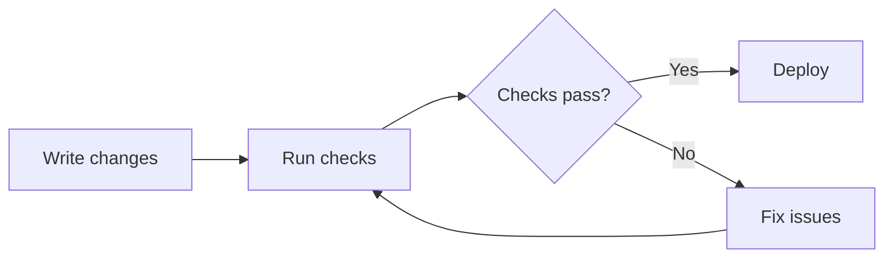

# Write Markdown

Use Markdown to make information easy to scan, navigate, and maintain.

## Rules

- Use one H1 for the document title.
- Lead with a short summary that explains the document's purpose.
- Prefer structured formats over prose when they improve clarity.
- Do not reply with a summary in the chat, reply with the path to the markdown document instead.

## Choose the right format

| Content type | Preferred format |
| --- | --- |
| Comparisons/options | Table |
| Steps | Numbered list |
| Unordered facts | Bullet list |
| Flows/relationships/architecture | Mermaid diagram |
| File layouts | Code block tree |
| Commands/code | Fenced code block with language |

## Style guidance

- Keep list items short; split complex items when needed.
- Use terminology consistently throughout the document.
- Prefer relative links for files and other documents in the repository.

## Example: Deployment flow

Deploy changes after validation succeeds:

